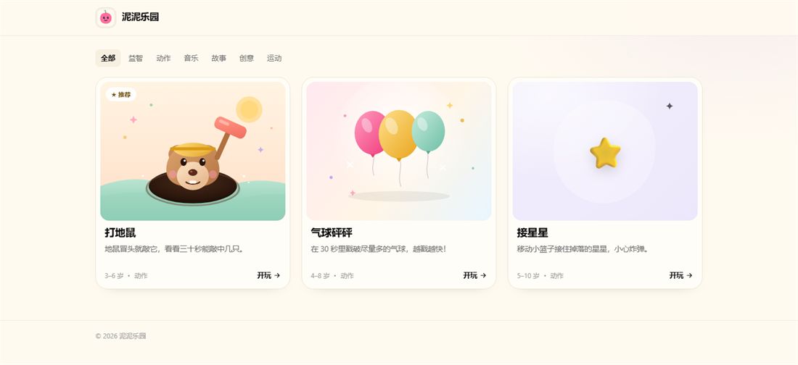
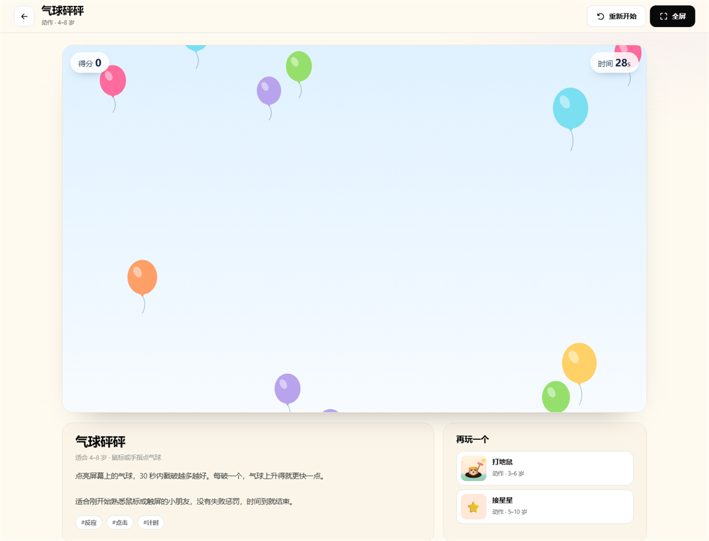

# 泥泥乐园 · Clay Play

给小朋友的自托管小游戏乐园。一个 Rust 二进制，前端内嵌，游戏就是仓库里的静态文件夹。





手机端效果见 [docs/mobile.png](docs/mobile.png)。

- **没有账号、没有广告、没有上传接口**：打开网页就能玩，关掉就结束。
- **单二进制部署**：`clayplay` + `games/` + `site.json`，运行期只读、无数据库。
- **游戏随代码走**：每个游戏是一个文件夹，用 git 管理、评审和回滚。
- **开发即改即看**：运行中每 10 秒扫描一次 `games/`，保存后刷新页面即可。
- **Clay 设计语言**：奶油底色、糖果色封面、大圆角、黏土插画，详见 [docs/DESIGN.md](docs/DESIGN.md)。

## 快速开始

需要 Rust 1.80+。

```bash
cargo run                 # 监听 0.0.0.0:8080
# 或者开发模式（127.0.0.1:8787 + 热加载）
./scripts/dev.sh
```

Windows：

```powershell
.\scripts\dev.ps1
```

打开 <http://127.0.0.1:8787> 就能看到首页。

## 添加一个游戏

游戏目录长这样：

```text
games/
  balloon-pop/
    game.json      # 必填：标题、分类、配色……
    index.html     # 入口，默认 index.html
    cover.svg      # 可选封面，也支持 png/jpg/webp/gif
    assets/...     # 其他静态资源，相对路径引用
```

复制模板开始：

```bash
cp -r games/_template games/my-game
```

仓库里的 `balloon-pop`、`star-catch`、`whack-a-mole` 是示例（其中打地鼠来自家里的旧项目），可以随时删掉。

`game.json` 示例：

```json
{
  "title": "气球砰砰",
  "summary": "在 30 秒里戳破尽量多的气球，越戳越快！",
  "description": "给游戏页展示的详细介绍，可以换行。",
  "category": "动作",
  "tags": ["反应", "点击", "计时"],
  "age": "4–8 岁",
  "accent": "pink",
  "icon": "🎈",
  "cover": "cover.svg",
  "controls": "鼠标或手指点气球",
  "featured": false,
  "order": 1,
  "published": true
}
```

| 字段 | 必填 | 说明 |
| --- | --- | --- |
| `title` | 是 | 卡片和游戏页标题，1–80 字 |
| `summary` | 否 | 一句话介绍，最多 200 字 |
| `description` | 否 | 详细介绍，游戏页展示，最多 8000 字 |
| `category` | 否 | 分类，默认「益智」；建议与 `site.json` 的 `categories` 对应 |
| `tags` | 否 | 最多 12 个，每个最多 24 字 |
| `age` | 否 | 适龄文案，例如 `4–8 岁` |
| `accent` | 否 | 卡片配色：`pink` `teal` `lavender` `peach` `ochre` `mint` `coral` |
| `icon` | 否 | 没有封面时显示的 emoji |
| `cover` | 否 | 封面相对路径；留空会自动找 `cover.*` |
| `entry` | 否 | 入口 HTML，默认 `index.html` |
| `controls` | 否 | 操作说明，显示在卡片和游戏页 |
| `featured` | 否 | 是否首页推荐（同时只会展示第一个推荐位） |
| `order` | 否 | 手动排序，越小越靠前；0 表示未设置 |
| `published` | 否 | `false` 时不出现在列表、也打不开 |

**文件夹名就是 URL**：`games/balloon-pop` → `/play/balloon-pop`。只允许 2–48 位小写字母、数字和连字符。以 `_` 或 `.` 开头的目录会被忽略（模板、草稿都安全）。

游戏运行在 `<iframe sandbox="allow-scripts allow-same-origin ...">` 里，可以直接用 Canvas、WebAudio、localStorage、Pointer Events；资源请用**相对路径**引用，便于平台托管在子路径下。

## 站点配置

`site.json` 控制站点标题、副标题、简介和分类：

```json
{
  "title": "泥泥乐园",
  "tagline": "小手点一点，快乐玩一天",
  "description": "给小朋友的迷你游戏乐园。",
  "accent": "pink",
  "categories": ["益智", "动作", "音乐", "故事", "创意", "运动"]
}
```

## 构建发布目录

```bash
./scripts/build.sh       # Linux / macOS
.\scripts\build.ps1      # Windows PowerShell
```

脚本会先 `cargo build --release`，再用 `clayplay --check` 严格校验每个游戏，最后生成：

```text
dist/
  clayplay            # 单二进制（前端已内嵌）
  games/              # 所有已发布/草稿游戏（模板已剔除）
  site.json
  VERSION             # git describe 或时间戳
```

`dist/` 就是完整的部署单元：整目录拷到服务器即可，不需要 Node、不需要数据库、不需要写权限。

也可以手动校验而不启动服务：

```bash
cargo run -- --check
```

## 部署到 Ubuntu

见 [DEPLOY.md](DEPLOY.md)。三种方式都给了：systemd + nginx、Docker、直接跑二进制。

最短路径：

```bash
./scripts/build.sh
scp -r dist/* user@server:/opt/clayplay/
sudo cp deploy/clayplay.service /etc/systemd/system/
sudo systemctl enable --now clayplay
```

## 配置项

| 环境变量 | 默认值 | 说明 |
| --- | --- | --- |
| `CLAY_BIND` | `0.0.0.0:8080` | 监听地址；生产建议 `127.0.0.1:8080` |
| `CLAY_GAMES_DIR` | `games` | 游戏目录 |
| `CLAY_SITE_FILE` | `site.json` | 站点配置 |
| `CLAY_WATCH` | `1` | 是否每 10 秒热加载；生产建议 `0` |
| `RUST_LOG` | `clayplay=info,tower_http=warn` | 日志级别 |

命令行参数可以覆盖环境变量：`--bind`、`--games`、`--site`、`--no-watch`、`--check`。

## HTTP 接口

| 方法 | 路径 | 说明 |
| --- | --- | --- |
| GET | `/` | 首页 |
| GET | `/play/{slug}` | 游戏页 |
| GET | `/games/{slug}/{path}` | 游戏静态资源（支持 Range） |
| GET | `/covers/{slug}` | 游戏封面 |
| GET | `/api/site` | 站点配置 |
| GET | `/api/games` | 已发布游戏列表 |
| GET | `/api/games/{slug}` | 单个游戏 |
| GET | `/healthz` | 健康检查 |
| GET | `/assets/{path}` | 平台前端资源（内嵌） |

## 项目结构

```text
src/
  main.rs       启动、--check、热加载
  config.rs     环境变量 / 命令行
  models.rs     game.json、site.json 数据结构与校验
  store.rs      扫描 games/、只读内存目录、严格校验
  server.rs     Axum 路由与安全响应头
  pages.rs      首页 / 游戏页 / 404 的模板注入
  games.rs      游戏静态资源、封面、Range
  assets.rs     内嵌前端资源
  api.rs        JSON 接口
web/
  index.html play.html 404.html
  assets/css/app.css
  assets/js/{common,home,play}.js
  assets/img/{mascot,favicon}.svg
  assets/fonts/baloo2-latin.woff2
games/
  _template/    复制它开始新游戏
  balloon-pop/  star-catch/  whack-a-mole/   ← 示例，可删
deploy/
  clayplay.service nginx.conf install.sh
scripts/
  build.sh build.ps1 dev.sh dev.ps1
Dockerfile docker-compose.yml
site.json
```

## 设计来源

界面按 [VoltAgent/awesome-design-md](https://github.com/VoltAgent/awesome-design-md) 里的 **Clay** 设计规范实现：奶油画布 `#fffaf0`、近黑主按钮、六色高饱和卡片、大圆角与紧凑圆体标题。仅使用其公开的设计 token 作为风格参考；黏土小怪兽、山丘、贴纸等插画为本项目原创 SVG。细节见 [docs/DESIGN.md](docs/DESIGN.md)。

## 开发命令

```bash
cargo test                 # 单元 + 路由测试
cargo fmt                  # 格式化
cargo clippy --all-targets -- -D warnings
./scripts/build.sh         # 发布目录
```

## License

MIT，见 [LICENSE](LICENSE)。
